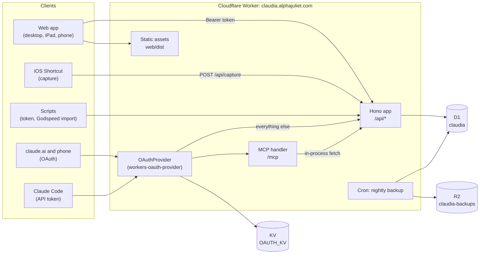

# Architecture

An overview of how Claudia is put together: what runs where, how a request travels, and where each kind of rule lives. The reasoning behind the choices, and the dated decisions, are in the Obsidian note **Claudia: own task store on Cloudflare**; feature designs are in [`docs/plans/`](plans/). This page describes the code as of November 2026.

## At a glance

One Cloudflare Worker on `claudia.alphajuliet.com` serves everything:

- **`/api/*`**: the REST API (Hono with `@hono/zod-openapi`), described at `/api/openapi.json`.
- **`/mcp`**: the remote MCP server for Claude, plus the OAuth endpoints (`/authorize`, `/token`, `/register`, `/.well-known/*`).
- **Everything else**: the web app, a React single-page app served as static assets.



The Worker is never served from `*.workers.dev` (`workers_dev: false` in `wrangler.jsonc`), because corporate filters may block it.

## Repository layout

An npm workspaces monorepo, TypeScript throughout:

| Workspace | What it holds |
| --- | --- |
| `shared/` | Zod schemas for every API shape (`schemas.ts`), plus date helpers (`dates.ts`, `when.ts`) and the quick-add parser (`quickAdd.ts`) that the Worker and the web app both use. |
| `worker/` | The Worker: API routes, domain rules, MCP server, OAuth consent page, backups, D1 schema and migrations, and scripts (token minting, Godspeed import). |
| `web/` | The Vite + React web app. `npm run build` writes `web/dist`, which the Worker serves. |

```
worker/src/
  index.ts          entry point: OAuthProvider, Hono app, cron handler
  routes/           one file per resource; parse the request, call the domain, shape the response
  domain/           the rules: tasks.ts (create, update, move, complete, delete, find), views.ts (built-in views)
  lib/              auth, D1 helpers, events, IDs, fractional positions, labels, recurrence, the router factory
  mcp/              MCP handler, server and tool definitions
  oauth/            consent page, passphrase check, redirect allowlist
  db/schema.ts      Drizzle schema (the source for migrations)
  backup.ts         SQL dump to R2
worker/migrations/  SQL migrations for wrangler d1 migrations
web/src/
  session/          token storage, apiFetch, the signed-in gate
  data/queries.ts   TanStack Query hooks and optimistic cache updates
  ui/               screens and components, the keyboard registry, the task panel
  lib/              pure logic: commands and keymap, reordering, swipes, views, grouping
```

## The Worker

### Request flow

`worker/src/index.ts` exports a `fetch` handler that hands every request to `OAuthProvider`:

1. **`/mcp`** needs a bearer token. The provider accepts either an OAuth access token it issued, or a Claudia API token (through `resolveExternalToken`, which looks it up in D1). It then calls the MCP handler with the caller's identity and scopes.
2. **The OAuth endpoints** (`/token`, `/register`, discovery) are handled by the provider itself. `/authorize` is the consent page in `oauth/consent.ts`, served by the Hono app.
3. **Everything else** goes to the Hono app. Paths under `/api/*` are routed there; for any other path the asset binding serves the web app first (`run_worker_first` lists only the API, MCP and OAuth paths), with single-page-app fallback to `index.html`.

Inside the Hono app, middleware on `/api/*` creates the Drizzle client and authenticates the caller (`lib/auth.ts`). `/api/health` and `/api/openapi.json` are public. Errors thrown as `ApiError` become `{ error: { code, message, issues } }` responses; validation failures use the same shape with code `validation_error`.

### API first

Every capability the web app has exists in the API. The Zod schemas in `shared/` are the single source for:

- request validation and responses in the routes (`createRoute` from `@hono/zod-openapi`),
- the OpenAPI document at `/api/openapi.json`,
- the MCP tool input schemas (`mcp/tools.ts` reuses the shapes, converted to JSON Schema),
- parsing responses in the web app (`data/queries.ts` parses with the same schemas).

Resources: `folders`, `lists`, `tasks` (including `move`, `complete`, `uncomplete`), `labels`, `filters` (saved queries, run with `/api/filters/{id}/tasks`), `views` (built-in views and their counts), `counts` (per-list counts for the sidebar), `capture` (one line into the Inbox), `settings`, `tokens`, `me`, `import` and `backup`.

### Routes and domain

Routes parse the request and call plain functions; the rules live in `worker/src/domain/`:

- **`domain/tasks.ts`**: creating, reading, updating, moving, completing and deleting tasks, and the shared query conditions (`openTask`, `dueBy`, `activeBy`, `hasLabel`, `notSnoozed`). Each change writes its rows and its event in one batch.
- **`domain/views.ts`**: the built-in views (Inbox, Today, Next, WIP, Waiting, Someday), defined once so the web app, MCP and the counts agree. A view is open, unsnoozed tasks in the chosen context's lists; Today is due or started by today in the user's time zone, and the others are a label.

- **`domain/folders.ts`**: a subfolder's context follows its parent's. Creating, moving or changing the context of a folder sets it on every folder under it too, because the sidebar shows a subfolder only in its own context.

The other resources (lists, labels, filters, and the rest of folders) still keep their logic in the route files. They are simpler and have less shared logic.

### Data model

D1 (SQLite) through Drizzle ORM. The schema is `worker/src/db/schema.ts`; migrations are generated with `npm run db:generate -w @claudia/worker` and applied with `wrangler d1 migrations`.

| Table | Purpose |
| --- | --- |
| `folders` | Nested folders. A top-level folder's `context` (work, personal, home) applies to everything under it. |
| `lists` | Lists, in a folder or none. One list is flagged as the Inbox (`inbox`), so renaming it is safe. Archived lists drop out of views. |
| `tasks` | Tasks and headings (`kind`), nested with `parent_id`. Dates: `due_date` or `due_at` (never both), `start_date`, `snoozed_until`. Recurrence: `recur_rule` and `recur_from`. Also `priority`, `completed_at`, `metadata` (JSON, such as Godspeed fields). |
| `labels`, `task_labels` | Labels with a colour, and which tasks carry them. Names are unique ignoring case. |
| `filters` | Saved filters: a name and a task query string. |
| `settings` | Key/value settings, such as `timeZone` and `keymap`. |
| `tokens` | API tokens: SHA-256 hash, name, scopes, expiry, last use, revocation. |
| `events` | The append-only change log (below). |

Conventions that hold across the tables:

- **IDs** are ULIDs (`lib/ids.ts`, monotonic).
- **Order** uses fractional index strings in `position` (`lib/position.ts`). Unique partial indexes on live siblings mean two items never share a position. Parallel creates that clash retry from scratch (`retryOnConflict` in `lib/db.ts`), up to 8 times, then give a 409.
- **Deletes are soft**: `deleted_at` is set and every query filters on it.
- **Dates** are stored in UTC; date-only fields are `YYYY-MM-DD`. The user's time zone (default `Australia/Sydney`) decides what "today" means.
- **Atomicity**: D1 has no interactive transactions, so a change and its event go in one `db.batch([...])` (`runBatch`).

### Events

Every change writes a row to `events`: entity type and ID, event type, `before` and `after` JSON, time and actor. SQLite triggers (`migrations/0001_events_append_only.sql`) abort any `UPDATE` or `DELETE` on the table. The actor comes from the `X-Claudia-Client` header (`web`, `mcp`, `shortcut`, `cli`, `import`). It is for the audit trail and doesn't grant anything. There is no API to read the log yet.

### Recurrence

Recurring tasks have an RRULE (daily or longer) and `recur_from` (`due` or `completion`). Nothing runs on a schedule: completing a recurring task advances it in place (`setCompleted` in `domain/tasks.ts`, with `lib/recurrence.ts`). The due date moves to the next occurrence, the start date shifts by the same number of days and the snooze clears. A `completed` event records the old and new dates. Tasks with a due time (`due_at`) don't recur yet; the web app disables times on repeating tasks.

### Authentication and scopes

| Caller | Credential | Scopes |
| --- | --- | --- |
| Web app | An API token pasted at sign-in, kept in `localStorage` (`claudia.token`) | Usually `write` |
| iOS Shortcut | Its own API token | `write` |
| Scripts | An API token (`npm run token:create` mints the first admin one straight into D1) | `admin` for import and backup |
| Claude Code | An API token, sent to `/mcp` as a bearer | Its token's scopes |
| claude.ai and the phone | OAuth, approved on the consent page with the owner passphrase | `tasks:read` or `tasks:write`, never admin |

API tokens look like `cl_…`. Only their SHA-256 hash is stored, and `last_used_at` is updated at most hourly. Scopes rank `admin` > `write` > `read`. `GET` needs `read`, other methods need `write`, and `/api/tokens`, `/api/import` and `/api/backup` need `admin`. OAuth client registration only accepts Claude's hosted callbacks and loopback addresses (`oauth/policy.ts`). OAuth grant state lives in the `OAUTH_KV` namespace. There is no Cloudflare Access in front: one user and moderately sensitive data.

### MCP

`mcp/handler.ts` builds an MCP server for each request (`createMcpHandler` from `agents`). The tools in `mcp/tools.ts` don't reach the database themselves: each tool turns its arguments into an API request and the handler sends it to the Hono app in-process. So the API's validation, rules, scopes and events apply unchanged:

- An **API-token** caller's own token is forwarded as the bearer.
- An **OAuth** caller is sent with an internal key that is random per isolate and never leaves it (`lib/internal.ts`), plus the grant's scopes. Admin is never granted this way.

Incoming `X-Claudia-*` headers are never forwarded. Read tools (search, get, views, list folders, lists, labels and filters) are always offered. Write tools (create, update, move and complete tasks; create, update and move lists and folders; labels; filters) are offered only with `write`. The resource URL in `index.ts` is hard-coded to production.

### Scheduled work and backups

A cron trigger (`0 16 * * *`, 2 to 3 am in Sydney) runs `backUp` in `backup.ts`. It dumps every table to SQL, parents before children, and writes it to the `claudia-backups` R2 bucket under `nightly/`, kept 30 days. `POST /api/backup` (admin) makes one on demand. CI also records a D1 Time Travel bookmark before applying migrations. Restoring is in [`backups.md`](backups.md).

## The web app

### Stack

React 19 with Vite, `wouter` for routing, TanStack Query for server state, and hand-written CSS (`styles.css`) with light and dark themes. There's no component library. The app is installable to the home screen (`public/manifest.webmanifest` and icons). There's no service worker yet, so it doesn't work offline.

### Session

`App.tsx` gates on the session (`session/SessionProvider.tsx`). The token is checked with `GET /api/me` and stored in `localStorage`. A rejected token signs out, and a network failure shows "Can't reach Claudia" with the token kept. `session/api.ts` adds the `Authorization` and `X-Claudia-Client: web` headers to every call.

### Screens and layout

Routes (`ui/AppShell.tsx`): `/` (home), `/list/:id`, `/filter/:id`, `/search`, `/dashboard`, `/labels`, and `/:view` for the built-in views. The selected task is in the address as `?task=<id>` on whatever screen is showing, so reload and Back keep it (`ui/selection.ts`).

One responsive layout covers three devices:

- **Desktop**: a sidebar (folders, lists, views, filters, narrowed by the All/Work/Personal/Home context), the task list, and the task panel beside it.
- **iPad**: the same panes. The sidebar becomes a drawer below 900px, and from 700px wide the panel sits beside the list at 340px.
- **Phone**: the list full-screen, with the task as a sheet. Rows swipe right to complete and left for Date and Snooze. Touch screens get a compact layout with 36px rows on a phone and 40px on an iPad.

Lists and folders are managed from the sidebar. Each list, folder and the Lists heading has a ⋯ menu (`ui/RowMenu.tsx`), shown on hover with a mouse and always on touch. New lists and folders are named in place, and empty ones can be deleted. Lists and folders drag to a new place with the same gesture as tasks (`ui/useListDrag.ts`, with the rules in `lib/listMove.ts` and `lib/folderMove.ts`).

### Data layer

`data/queries.ts` wraps every API call in TanStack Query hooks, with query keys such as `["tasks", …]`, `["lists"]` and `["counts", …]`. Task changes are optimistic. They update every cached list that holds the task at once, put back only the affected tasks on failure, and refetch once the last change settles. Creates are refetched rather than placed locally, because which views a new task belongs in is the server's decision. The views' contents come from the server (`/api/views/{id}/tasks`); the web app only names and links them (`lib/views.ts`).

### Keyboard

Every action is a command (`lib/commands.ts`: ID, label, default keys, which follow Godspeed). `ui/keyboard.tsx` has one window `keydown` listener and a registry. Components register handlers with `useCommand`, and the handler registered most recently runs first; it can return `false` to pass the key on. `lib/keymap.ts` matches keys and two-key chords (`g t`, `e d`), reads ⌥ letters from `KeyboardEvent.code`, and leaves keys typed into text fields alone. The `?` overlay lists every command. The `keymap` setting exists in the API, but there's no editor in the app yet.

### Undo

Completing, snoozing and moving to another list offer Undo in a toast, and the last one stays undoable with `z` after the toast fades. On touch screens, shaking the device can undo too (`ui/shakeToUndo.tsx`), once motion access is turned on.

## Build, test and deploy

- **Local**: `npm run dev` builds the web app and runs `wrangler dev` on http://localhost:8787. `npm run dev:web` runs Vite with hot reload, proxying `/api` and `/mcp` to the Worker.
- **Tests**: Worker tests run inside workerd (`@cloudflare/vitest-plugin`) against a local D1, so they cover the routes, the domain and the migrations together. Storage is shared across tests, so each test file resets the tables in `beforeEach`. Web tests use Vitest with jsdom and Testing Library, against a stubbed `fetch` (`ui/testApi.tsx`). Shared code has its own unit tests.
- **CI** (`.github/workflows/deploy.yml`, on push to `main`): install, typecheck, test, build, record a D1 Time Travel bookmark, apply migrations to production, `wrangler deploy`.

## Getting data in

- **Quick add** in the app and **`POST /api/capture`** (the iOS Shortcut) share the parser in `shared/src/quickAdd.ts`: `#labels`, plus a date or time at the end of the text.
- **Godspeed import**: `godspeed:fetch` downloads the account to `worker/godspeed-export/`, and `godspeed:import` sends it through `POST /api/import`. Import IDs are derived from Godspeed's, so it is safe to repeat.

## Known gaps

These are tracked on the Workflowy board:

- Lists and views return at most 500 tasks, with no paging in the app.
- Saved filters use the task query parameters; Godspeed's richer smart-list language (boolean logic, relative dates) isn't built.
- No events/history endpoint, and deleted tasks can't be restored yet.
- Recurring tasks with a due time don't advance.
- The web app parses responses with the shared schemas but has no generated, typed API client.
- Not built: offline capture and a cached Today, a keymap editor, notifications and sharing.
